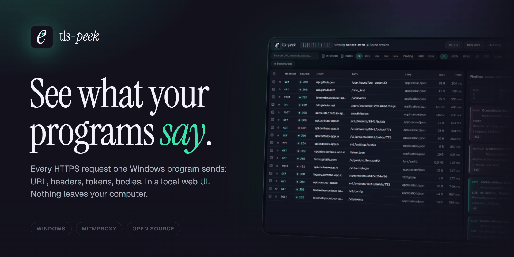

# tls-peek

See the HTTPS requests (URL, headers, tokens, bodies) one Windows desktop
program sends, in a local web UI. Built on mitmproxy `local` mode (WinDivert),
so it works on programs that ignore the system proxy. Capture needs
administrator rights.

> For authorized work on systems you own or administer. Captures contain
> credentials and personal data: keep them private and delete them when done.

## Features
- **Interface:** dark or light (follows Windows, switchable), a request ribbon showing traffic over the last minute, and a command palette on `Ctrl K` (`/` focuses search) for panels, hosts, requests and actions. Fonts (Geist, Instrument Serif, OFL) ship with the app; nothing is loaded from the internet.
- **Start page:** start a capture, open, download or delete saved sessions, and remove a leftover certificate.
- **Per-program capture:** pick a running app (or type an `.exe` name); only its traffic is intercepted.
- **Live control:** switch program and host filter, pause/resume, stop, all from the UI or the tray icon.
- **Auto-stop:** closing the last UI tab stops the capture after 10 s (5 min without any tab as a fallback).
- **Request list:** pending requests, status/type/host/bookmark filters, URL, header or body search (plain or regex), sortable and resizable columns, waterfall timeline.
- **Request detail:** headers, query, pretty JSON, WebSocket messages, image and sandboxed HTML previews. Event streams (SSE, NDJSON) pass through as they arrive and show their events while open.
- **Raw traffic:** non-HTTP TCP and UDP streams as text and hex, DNS lookups with their answers, and each HTTP request and response as it looks on the wire with header and body byte counts.
- **Connection:** TLS version, cipher, ALPN, SNI and addresses on both sides, the server certificate chain, and timing split into connect, TLS, send, wait and download (also in the waterfall).
- **Decoders:** JWTs found in headers, URL or body; Base64; mitmproxy's views (protobuf, gRPC, msgpack, hex, ...).
- **Intercept:** hold requests and/or responses matching a URL and method, edit them, then continue or drop; the program gets the edited version. Clicking Intercept again turns it off and sends held traffic on unchanged.
- **Rewrite rules:** set or remove a header, find and replace in URL or body, or answer with a fixed response, automatically and without holding; response rules can be limited to a status such as `5xx`. The row tag lists which rules changed it. **New rule…** on a request starts one for its URL with the captured response. Rules are saved for the next capture.
- **Work with requests:** bookmarks and notes, edit and resend, duplicate, compare two as a diff (or a resend with its original), copy as cURL/PowerShell/Python/fetch/HTTPie or as the raw request.
- **Send requests:** **Requests…** writes a new request or fills one from a pasted cURL command (bash or cmd form). Ticking **Save to captures** keeps it in `captures\saved-requests.json`, where the same menu sends it again or edits it first.
- **API map:** requests grouped into endpoints (`/users/123` and `/users/octocat` become `/users/{id}` and `/users/{name}`) with calls, statuses, median time, the last failure with its error text, paging style (page, offset, cursor, Link header), OAuth flow details and JSON shapes (mixed types as `oneOf`); OpenAPI 3 download per host.
- **Findings:** passive checks on requests and responses: credentials in URLs and paths, passwords over HTTP or in response bodies, plain HTTP (loopback and LAN shown as info), Basic auth, JWTs with alg none or no expiry, CORS with credentials, cookie flags, stack traces and 5xx, old TLS, weak ciphers, expired, expiring, self-signed or mismatched certificates, missing HSTS and page security headers, 429 and 407 answers, version headers, URLs called on a steady timer, retries after errors, refused requests (with or without credentials), failed CORS preflights, card numbers, email addresses and device identifiers (the kind is named, never the value). Nothing is skipped quietly.
- **Stats:** totals, median and p95 time, status and type counts, per-host table with IP, TLS, HTTP version, median, p95 and time to first byte, plus hosts that refused the certificate. **Who received data** groups hosts by domain (with analytics/ads hints), lists the identifiers, personal data and cookies each one got, and shows 429 answers, Retry-After and remaining quota per host. Time spent held in Intercept is not counted as request time.
- **Dismiss and download:** a finding can be dismissed per host (it stays listed, greyed out, and is not counted); the panel downloads as JSON.
- **Export:** HAR or Postman collection, for all, filtered or selected requests, credentials masked by default. The file says how many values were masked and which fields; failed requests stay in it with status 0. The HAR saved on Stop gets a `.sha256` file next to it.
- **Sessions:** every capture streams to `captures\session-<time>.mitm`; open it later in the same UI. **Open folder** on the start page shows them.
- **CA hygiene:** fresh CA per session, untrusted and deleted on stop, on window close and at the next start.

## Setup
Download from [Releases](https://github.com/kaan0d/tls-peek/releases/latest), no Python needed. Two builds of the same program:
- `tlspeek.exe`: one file. It unpacks itself to `%TEMP%` on every start.
- `tlspeek-windows.zip`: a folder. Unzip anywhere and run `tlspeek\tlspeek.exe`. Use it when antivirus flags the single exe (it does not unpack at start). Both builds keep their data in the same folder.

To check a download, compare `certutil -hashfile <file> SHA256` with its line in `SHA256SUMS` from the same release.
Antivirus may still warn (root certificate, WinDivert driver and admin rights look alike to malware heuristics): add an exclusion or report a false positive.

From source: `tlspeek.cmd` installs Python 3.13 (winget, or the
python.org installer) and `mitmproxy pystray pillow` (`pip install --user`) on first run.

Or build the exe yourself:
```
pip install mitmproxy pystray pillow pyinstaller
pyinstaller --onefile --name tlspeek --icon app/icon.ico --hidden-import pystray._win32 --add-data "ui;ui" --add-data "app/addon.py;." app/tlspeek.py
```
The exe lands in `dist\`. Use `--onedir` instead of `--onefile` for the folder build. CI also adds `--version-file app/version_info.txt`.

## Usage
1. Download `tlspeek.exe` or `tlspeek-windows.zip` from Releases (see Setup).
   - **exe:** double-click it, or run it from a terminal.
   - **zip:** unzip it anywhere, open the `tlspeek` folder and double-click `tlspeek.exe`. Same program, but it does not unpack itself at start, which antivirus products like better.
2. The start page opens in your browser. Click **Start capture** and accept the Windows administrator prompt. A tray icon appears.
3. Pick the program to watch (tick **Background** for tray apps), optionally set a host filter, then close and reopen that program and do the action. Only connections opened after the capture starts are seen.
4. Read the traffic in the browser. `Ctrl K` jumps to panels, hosts and requests.
5. Press **Stop** (in the page or the tray). The capture is saved, the temporary certificate is removed and the page returns to the start page, where saved sessions can be opened again.

```
tlspeek.exe                        start page
tlspeek.exe capture                start a capture right away
tlspeek.exe open FILE.mitm         view a saved session (or drop the file on the exe)
tlspeek.exe report FILE.mitm --fail-on high   findings for scripts; exit code 1 at or above that level
tlspeek.exe cleanup                remove the certificate after a crash
```

Captures and `settings.json` live in `%LOCALAPPDATA%	ls-peek`. Captures contain credentials: keep them private.
